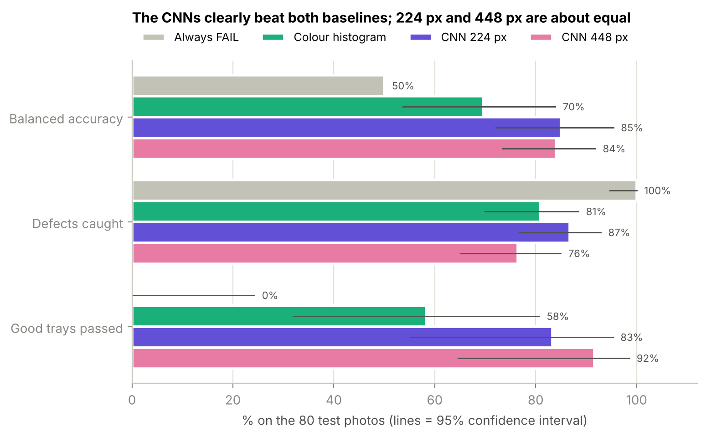

# Pork Rasher Packaging Inspection

Automated **pass/fail inspection** of packaged pork rasher trays from RGB photos, comparing two baselines with a transfer-learning CNN.

MMA3001 – Numerical Methods and Machine Learning, Monash University, 2026 (individual project, Dataset 3).



## Problem

Food-packaging lines rely on people looking at every tray to catch defects such as loose or twisted rashers, unsealed lids, wrinkled film or other packaging errors. This project asks: **can a camera photo of a tray be classified as PASS or FAIL automatically, accurately and fast enough for a production line?** The intended use is to support inspectors (flagging trays for a second look), not to replace them.

## Inputs and outputs

| | Description |
|---|---|
| **Input** | RGB photo of one tray on the conveyor belt, JPEG, 720 × 540 px (any size is accepted; photos are resized internally) |
| **Output** | `0` = **PASS** (no defect visible) or `1` = **FAIL** (at least one defect visible); the CNN also gives P(FAIL) between 0 and 1 |
| **Labels used for training** | Derived from the dataset's bounding boxes: a photo with ≥ 1 defect box is FAIL, otherwise PASS |

Invalid inputs: an unknown split name raises `ValueError`; a missing annotation file raises `FileNotFoundError`; file names without a Roboflow suffix are kept unchanged; greyscale or RGBA photos are converted to RGB before use.

## Results (test set, 80 photos: 68 FAIL, 12 PASS)

| Model | Balanced accuracy (95% CI) | Defects caught | Good trays passed | CPU time / photo |
|---|---|---|---|---|
| Always FAIL (trivial baseline) | 50.0% | 68 / 68 | 0 / 12 | – |
| Colour histogram + logistic regression | 69.6% (54–84%) | 55 / 68 | 7 / 12 | ~3 ms* |
| **MobileNetV2 CNN, 224 px** | **85.0% (72–95%)** | **59 / 68** | 10 / 12 | 51 ms |
| MobileNetV2 CNN, 448 px | 84.1% (73–92%) | 52 / 68 | 11 / 12 | 75 ms |

\* includes loading the JPEG; CNN times are for the network only. Balanced accuracy is used because ~80% of photos are FAIL – a model that always answers FAIL scores 85% plain accuracy.

**Recommended model: CNN at 224 px.** Doubling the resolution needed 3.8× the computation and 2.5× the training time without improving accuracy. Main limitations: small test set (12 PASS photos, wide intervals), one camera and belt, each CNN trained once, and "PASS" means "no defect visible in this photo". Details are in the notebooks and the report.

## Repository structure

```
pork-rasher-inspection/
├── data/raw/               # dataset goes here (not committed – see below)
├── docs/                   # HTML documentation of the source code (pdoc)
├── models/                 # trained CNN weights (not committed, created by notebook 03)
├── notebooks/              # 01–04: exploration, baselines, CNN, comparison
├── results/                # figures and JSON results used in the report
├── src/rasher_inspection/  # project source code
│   ├── data.py             #   loading annotations, pass/fail labels
│   ├── features.py         #   hand-crafted image features
│   ├── evaluate.py         #   metrics and confidence intervals
│   └── cnn.py              #   MobileNetV2 transfer learning
├── tests/                  # pytest tests
├── AI_USE_LOG.md           # running log of AI assistance
├── pyproject.toml          # pytest configuration
├── requirements.txt
└── LICENSE
```

## Setup

Tested with Python 3.12 on an Apple M1 MacBook Pro (16 GB). The CNN code automatically uses an NVIDIA GPU (CUDA), an Apple-silicon GPU (MPS) or the CPU.

```bash
git clone https://github.com/loganmazur-monash/pork-rasher-inspection.git
cd pork-rasher-inspection
python -m venv .venv
# Windows: .venv\Scripts\activate    macOS/Linux: source .venv/bin/activate
pip install -r requirements.txt
```

## Dataset

The dataset (MMA3001 Project Dataset 3, Roboflow export, Version 4) is **not** stored in this repository.

1. Download it from [Roboflow Universe](https://universe.roboflow.com/hello-2aqe0/pork-rasher-error-packaging) (Dataset tab → v4 → Download Dataset), format **COCO JSON**.
2. Unzip it into `data/raw/` so you have `data/raw/train/`, `data/raw/valid/` and `data/raw/test/`, each with an `_annotations.coco.json` file.

Source: *Pork Rasher Error(Packaging)*, Roboflow Universe, v4 (2025-02-09), licensed **CC BY 4.0**.
3,549 photos at 720×540 (train 3,349 = about 1,100 originals × 3 exposure copies; valid 120; test 80), with bounding boxes for five defect classes: `packaging-error`, `unsealed`, `twisted-meat`, `loose-meat`, `wrinkle`.

## Usage

Run the notebooks in order from the `notebooks/` folder (in VS Code or Jupyter, using the `.venv` kernel):

| Notebook | What it does | Run time (M1) |
|---|---|---|
| `01_explore_data.ipynb` | Class balance, defect types, near-duplicate check of the official split, defect sizes, shortcut check, test-set uncertainty | ~1 min |
| `02_baselines.ipynb` | "Always FAIL" and colour-histogram + logistic-regression baselines, with grouped cross-validation and 95% confidence intervals | ~30 s |
| `03_cnn.ipynb` | MobileNetV2 transfer learning at 224 px and 448 px: training curves, accuracy, FLOPs, time per photo. Set `QUICK_RUN = True` for a 2-minute check first | ~20 min |
| `04_comparison.ipynb` | Final comparison of all four models: results table, chart, confusion matrices, cost | seconds |

Notebook 04 only reads the JSON files in `results/`, so it runs without the dataset.

## Tests

```bash
python -m pytest
```

26 tests cover label derivation, data loading, features, metrics and confidence intervals, and the CNN building blocks (using small random images, so no dataset or GPU is needed). Use `python -m pytest` rather than `pytest` so the project's virtual environment is used.

## Documentation

HTML documentation of every module and function (generated from the docstrings) is in [`docs/`](docs/). Open `docs/index.html` in a browser. To regenerate it:

```bash
python -m pdoc src/rasher_inspection --docformat google -o docs
```

## AI use

AI assistance (Claude) is disclosed in [`AI_USE_LOG.md`](AI_USE_LOG.md) and discussed in the project report.

## License

Code: MIT – see [`LICENSE`](LICENSE). Dataset: CC BY 4.0, from the source above (not redistributed here).
